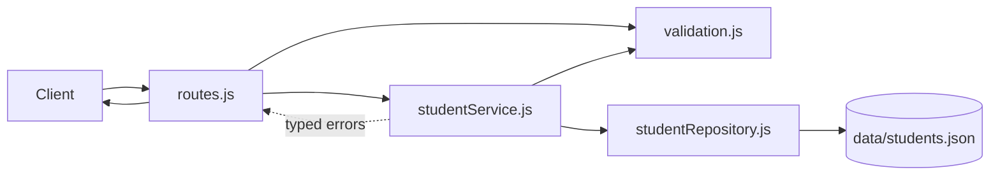

# Architecture: Student Management

Based on `docs/requirements.md` (approved). Repo is empty (no existing code or stack).

## 1. Stack recommendation
**Node.js 26 (JavaScript, CommonJS), zero runtime dependencies.** HTTP via built-in `node:http`, tests via built-in `node:test` + `node:assert`, run with `node --test`.
- Installed: Node 26.13.1, npm 12.2.3, Python 3.15.2. No Java/.NET. Node covers server, JSON, and test runner with nothing to install (NFR-4, NFR-5).
- Persistence: in-memory `Map` backed by a single JSON file (`data/students.json`), written atomically (write temp file, then rename) after each successful change. Chosen over SQLite because the data is one small table, single user, no concurrency (requirements s5); it needs no native or experimental module, and tests can run against a temp file or purely in memory.
- A small REST API lets the verification and PR phases exercise real behavior over HTTP.

## 2. Components
| Component | File | Responsibility |
|---|---|---|
| Server bootstrap | `src/server.js` | Create HTTP server, read port from `PORT` (default 3000), wire dependencies |
| Router / handlers | `src/routes.js` | Match method + path, parse ID and JSON body, call service, map results/errors to HTTP responses |
| Validator | `src/validation.js` | Normalize and validate student input (one function used by add and update, NFR-3); validate ID format |
| Student service | `src/studentService.js` | Business rules: create, list, get, update, delete; duplicate-email check; throws typed errors |
| Repository | `src/studentRepository.js` | Storage of records and ID counter; JSON-file load/save; email lookup (lowercased) |
| Errors | `src/errors.js` | Typed errors (`ValidationError`, `InvalidIdError`, `NotFoundError`, `ConflictError`) carrying code and HTTP status |

Dependency direction: routes -> service -> repository; routes and service use validator and errors.

## 3. Data model
Entity `Student`:
| Field | Type | Constraints |
|---|---|---|
| `id` | integer | System-assigned, positive, starts at 1, strictly increasing, never reused (counter `nextId` persisted with the data), never accepted from client |
| `name` | string | Required; trimmed; 1-100 chars |
| `email` | string | Required; trimmed; max 254 chars; format `local@domain.tld` (single `@`, no spaces, domain contains a dot); stored as entered (trimmed) |
| `course` | string | Required; trimmed; 1-100 chars |

Uniqueness: `email` unique by `trim().toLowerCase()`. Same name is allowed. On update, the student's own current email does not count as a duplicate.

File format: `{ "nextId": <int>, "students": [ {id,name,email,course}, ... ] }`. Missing file = empty store.

## 4. API contract
Base path `/students`, JSON only (`Content-Type: application/json`). Student JSON: `{ "id", "name", "email", "course" }`.

| Operation | Request | Success | FR |
|---|---|---|---|
| Add | `POST /students` body `{name,email,course}` | `201` + created student; `Location: /students/{id}` | FR-1, FR-2 |
| List | `GET /students` | `200` + array (`[]` if none), ordered by id | FR-3 |
| Get | `GET /students/{id}` | `200` + student | FR-4 |
| Update | `PUT /students/{id}` body `{name,email,course}` (full replacement; id unchanged) | `200` + updated student | FR-5 |
| Delete | `DELETE /students/{id}` | `204`, no body | FR-6 |

Unknown body fields (including `id`) are ignored; they never change the ID.

### Error format
All failures return `Content-Type: application/json`:
```
{ "error": { "code": "<CODE>", "message": "<specific cause>", "fields": [ { "field": "email", "message": "..." } ] } }
```
`fields` is present only for `VALIDATION_ERROR`.

| Condition | Status | `code` | FR / AC |
|---|---|---|---|
| Required field missing, blank, or not a string; malformed value (bad email, too long) | 422 | `VALIDATION_ERROR` (one `fields` entry per offending field, naming the field) | FR-7, FR-8 / AC-6, AC-7 |
| Request body is not valid JSON or not a JSON object | 400 | `INVALID_JSON` | NFR-1 |
| ID missing (e.g. `PUT /students/`), empty, non-numeric, zero, negative, decimal, leading zeros, or above `Number.MAX_SAFE_INTEGER` | 400 | `INVALID_ID` | FR-11 / AC-10 |
| Valid ID, no such student | 404 | `NOT_FOUND` | FR-10 / AC-9 |
| Email already used by another student (case-insensitive) | 409 | `CONFLICT` (message names `email`) | FR-9 / AC-8 |
| Unknown path | 404 | `ROUTE_NOT_FOUND` | - |
| Known path, unsupported method | 405 | `METHOD_NOT_ALLOWED` (with `Allow` header) | - |
| Body larger than 10 KB | 413 | `PAYLOAD_TOO_LARGE` | - |
| Unexpected failure | 500 | `INTERNAL_ERROR`, generic message only | - |

Check order per request: route/method -> ID format (400) -> body JSON (400) -> field validation (422) -> existence (404) -> duplicate email (409). The first failing check wins, so an invalid ID on update is reported as 400 even with a bad body.

## 5. Interaction flow

Add: parse body -> validate -> check duplicate email -> repository assigns `nextId`, stores, saves file -> 201.
Update: validate ID -> parse/validate body -> find (404) -> duplicate check excluding own id (409) -> replace record -> save -> 200.
Delete: validate ID -> find (404) -> remove -> save -> 204.

## 6. Error handling and validation strategy
- All validation and rule checks happen before any write; the repository mutates and saves only after every check passes, so a failed request never changes stored data (NFR-2). If saving fails, the in-memory change is rolled back and `500` is returned.
- One validator is used by add and update (NFR-3). It collects all field errors in one pass.
- Services throw typed errors; a single catch in `routes.js` converts them to the error format. Anything untyped becomes `500 INTERNAL_ERROR` with no stack trace or internals in the response; details go to server log only.
- Storage uses plain data operations (no SQL, no string-built queries), so there is no injection surface. Input is always treated as data; responses are JSON only.
- Messages are specific (e.g. `"email: must be a valid email address"`, `"Student 7 not found"`, `"Email already in use"`) and never echo stored data of other students.

## 7. Testing approach and project layout
```
src/    server.js routes.js validation.js studentService.js studentRepository.js errors.js
tests/  validation.test.js     (unit: required/blank/format/length, ID format)
        studentService.test.js (service + in-memory repository: CRUD, duplicates, ID not reused)
        api.test.js            (HTTP: start server on port 0, temp data file; status codes + error format)
data/   students.json          (created at runtime; git-ignored)
package.json                   ("start": "node src/server.js", "test": "node --test tests/")
```
- The repository accepts a file path or none (in-memory), so tests are isolated and need no cleanup beyond temp files.
- Every FR and AC has at least one test; each error row in section 4 has an API-level test, including "data unchanged after failure" (AC-11).

## 8. Requirement traceability
| Requirement | Component(s) / endpoint |
|---|---|
| FR-1 | `POST /students`; routes, service, repository |
| FR-2 | repository (`nextId` counter, never reused); `201` response returns `id` |
| FR-3 | `GET /students`; service, repository |
| FR-4 | `GET /students/{id}`; service, repository |
| FR-5 | `PUT /students/{id}`; service, repository |
| FR-6 | `DELETE /students/{id}`; service, repository |
| FR-7 | validator (required/blank) -> `422 VALIDATION_ERROR` |
| FR-8 | validator (email format, types, lengths) -> `422 VALIDATION_ERROR` |
| FR-9 | service duplicate check + repository email lookup -> `409 CONFLICT` |
| FR-10 | service lookup -> `404 NOT_FOUND` |
| FR-11 | validator ID check in routes -> `400 INVALID_ID` |
| NFR-1 | errors module + single error mapper in routes (error format) |
| NFR-2 | validate/check before write; save rollback on failure (service, repository) |
| NFR-3 | single shared validator for add and update |
| NFR-4 | zero dependencies, 6 source files, JSON file store |
| NFR-5 | `node:test` suites per layer in `tests/` |
