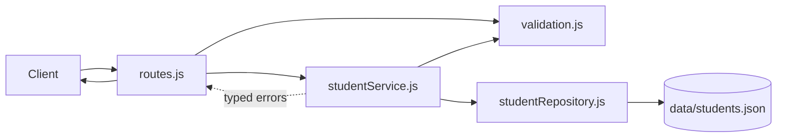

# Architecture: Student Management

Based on `docs/requirements.md` (approved). Repo is empty (no existing code or stack).

## 1. Stack recommendation
**Node.js 26 (JavaScript, CommonJS), zero runtime dependencies.** HTTP via built-in `node:http`, tests via built-in `node:test` + `node:assert`, run with `node --test`.
- Installed: Node 26.13.1, npm 12.2.3, Python 3.15.2. No Java/.NET. Node covers server, JSON, and test runner with nothing to install (NFR-4, NFR-5).
- Persistence: in-memory `Map` backed by a single JSON file (`data/students.json`, path overridable via optional `DATA_FILE` env), written after each successful change. Write is synchronous and atomic: `writeFileSync` to `students.json.tmp` in the same directory, then `renameSync` over the target; the temp file is removed on error. No fsync (optional at this scope). Chosen over SQLite because the data is one small table, single user (requirements s5); it needs no native or experimental module, and tests can run against a temp file or purely in memory.
- Concurrency: every mutation does check + build new state + persist + swap in one synchronous section (no `await` in between), so overlapping requests cannot interleave and FR-9/NFR-2 hold.
- A small REST API lets the verification and PR phases exercise real behavior over HTTP.

## 2. Components
| Component | File | Responsibility |
|---|---|---|
| Server bootstrap | `src/server.js` | Export `createServer({filePath, writer, log, logError})` (wires dependencies, returns a non-listening server; `writer`, `log` and `logError` are injectable for tests); call `listen` only under `require.main === module`, with `PORT` (default 3000; must be an integer 0-65535), `HOST` (default `127.0.0.1`, loopback only; env-overridable), optional `DATA_FILE`. An invalid `PORT`, an invalid data file or a listen error (e.g. `EADDRINUSE`) logs `Startup failed: <message>` and exits 1. Relies on `server.headersTimeout`/`requestTimeout` (Node defaults or set explicitly). Sends no CORS headers |
| Router / handlers | `src/routes.js` | Apply the routing rule (s4), parse ID and JSON body (streaming size limit, content-type check), call service, map results/errors to HTTP responses, log requests |
| Validator | `src/validation.js` | Normalize and validate student input (one function used by add and update, NFR-3), returning a fresh object built from exactly `name`, `email`, `course`; validate ID format |
| Student service | `src/studentService.js` | Business rules: create, list, get, update, delete; duplicate-email check; throws typed errors |
| Repository | `src/studentRepository.js` | `Map` storage of records and email index, ID counter; JSON-file load/validate/save; email lookup (lowercased); accepts an injectable writer (default: temp-file + rename) so tests can force save failures |
| Static files | `src/staticFiles.js` | Load `public/index.html`, `styles.css`, `app.js` once at startup into a fixed URL allow-list (`/`, `/styles.css`, `/app.js`); serve `GET`/`HEAD` with `Content-Type`, `Cache-Control: no-cache`, `X-Content-Type-Options: nosniff` and a CSP; other methods -> 405. Request paths are never joined to a directory |
| Frontend | `public/index.html`, `public/styles.css`, `public/app.js` | Vanilla HTML/CSS/JS dashboard (s11) |
| Errors | `src/errors.js` | Typed errors (`ValidationError`, `InvalidIdError`, `NotFoundError`, `ConflictError`, ...) carrying code and HTTP status |

Dependency direction: routes -> service -> repository; routes and service use validator and errors.

## 3. Data model
Entity `Student`:
| Field | Type | Constraints |
|---|---|---|
| `id` | integer | System-assigned, positive, starts at 1, strictly increasing, never reused (counter `nextId` persisted with the data), never accepted from client |
| `name` | string | Required; trimmed; 1-100 chars |
| `email` | string | Required; trimmed; checked in order: `length <= 254`, then regex `^[^\s@]+@[^\s@.]+(\.[^\s@.]+)+$` (linear-time, no nested quantifiers; no whitespace of any kind). Stored as entered (trimmed) |
| `course` | string | Required; trimmed; 1-100 chars |
| `status` | string | Amendment 3 (s12.1): exactly `Active` or `Inactive`, case-sensitive, no trim; defaults to `Active` |

Uniqueness: `email` unique by `trim().toLowerCase()`. Same name is allowed. On update, the student's own current email does not count as a duplicate.

File format: `{ "nextId": <int>, "students": [ {id,name,email,course,status}, ... ] }` (`status` is absent in records saved before Amendment 3; see s12.1).

Load rule (at startup):
- File missing: start empty (`nextId` = 1); `data/` is created with `mkdir({recursive:true})` before the first save.
- File present but invalid: **fail startup** with a clear log message (no student data in it); never auto-reset or overwrite. Invalid means: not parseable JSON, not an object, `nextId` not a safe positive integer, any record failing the validator or having an invalid/non-unique `id`, or emails not unique (case-insensitive).
- Amendment 3 (s12.1): a record with no `status` loads as `Active`; a record with a present but invalid `status` fails startup like any other invalid field.
- After a valid load: `nextId = max(nextId, maxId + 1)`, so IDs are never reused.
- Records and the email index are held in `Map`s (never plain-object keyed by user data).

## 4. API contract
Base path `/students`, JSON only (the dashboard assets at `/`, `/styles.css`, `/app.js` are the only non-JSON responses; see s11). Student JSON: `{ "id", "name", "email", "course", "status" }` (`status` added by Amendment 3, s12). `POST`/`PUT` (and `PATCH`, s12.3) must send `Content-Type: application/json` (parameters such as `charset` allowed), otherwise `415`. No CORS headers are sent, so cross-origin browser calls fail preflight.

**Routing rule (single, applied first).** Strip the query string (ignored), then match the path against `^/students(?:/([^/]*))?/?$`.
- No ID segment, or an empty one (`/students`, `/students/`): collection. `GET` = list, `POST` = add; `PUT`/`DELETE` = `400 INVALID_ID` (AC-10); other methods = `405`.
- One ID segment (`/students/5`, `/students/5/`): `GET`/`PUT`/`DELETE` act on that ID (segment validated per ID rule below); other methods (including `POST`) = `405`.
- Anything deeper or not matching (`/students/1/x`, `/other`) = `404 ROUTE_NOT_FOUND`. Exception (Amendment 3, s12.3): `/students/{id}/status` is a recognized path.

**ID rule.** Decode the segment once; it must match `^[1-9]\d*$` (so `%31` decodes to `1` and is fine, while `1%00`, `1e3`, `0x10`, ` 5 `, `007`, `0`, `-1`, `1.5` are rejected), then `Number(seg) <= Number.MAX_SAFE_INTEGER`. Never use `parseInt`/`Number` for the validity decision. Rejecting leading zeros is a deliberate choice stricter than "non-numeric".

Bodies on `GET`/`DELETE` are ignored (not buffered).

| Operation | Request | Success | FR |
|---|---|---|---|
| Add | `POST /students` body `{name,email,course}` | `201` + created student; `Location: /students/{id}` | FR-1, FR-2 |
| List | `GET /students` | `200` + array (`[]` if none), ordered by id | FR-3 |
| Get | `GET /students/{id}` | `200` + student | FR-4 |
| Update | `PUT /students/{id}` body `{name,email,course}` (full replacement; id unchanged) | `200` + updated student | FR-5 |
| Delete | `DELETE /students/{id}` | `204`, no body | FR-6 |
| Change status (Amendment 3, s12.3) | `PATCH /students/{id}/status` body `{status}` | `200` + updated student | FR-23, FR-24 |

Unknown body fields (including `id`) are ignored; they never change the ID.

### Error format
All failures return `Content-Type: application/json`:
```
{ "error": { "code": "<CODE>", "message": "<specific cause>", "fields": [ { "field": "email", "message": "..." } ] } }
```
`fields` is present only for `VALIDATION_ERROR`.

| Condition | Status | `code` | FR / AC |
|---|---|---|---|
| Required field missing, blank, or not a string; malformed value (bad email, too long) | 422 | `VALIDATION_ERROR` (one `fields` entry per offending field, naming the field) | FR-7, FR-8 / AC-6, AC-7 |
| Request body is not valid JSON or not a JSON object | 400 | `INVALID_JSON` | NFR-1 |
| ID missing (`PUT /students`, `DELETE /students`, `PUT /students/`), empty, or failing the ID rule above (non-numeric, zero, negative, decimal, leading zeros, above `Number.MAX_SAFE_INTEGER`) | 400 | `INVALID_ID` | FR-11 / AC-10 |
| Valid ID, no such student | 404 | `NOT_FOUND` | FR-10 / AC-9 |
| Email already used by another student (case-insensitive) | 409 | `CONFLICT` (message names `email`) | FR-9 / AC-8 |
| Unknown or too-deep path | 404 | `ROUTE_NOT_FOUND` (fixed message, path not echoed) | - |
| Known path, unsupported method | 405 | `METHOD_NOT_ALLOWED` (`Allow` header optional) | - |
| `POST`/`PUT` without `application/json` content type | 415 | `UNSUPPORTED_MEDIA_TYPE` | - |
| Body larger than 10 KB | 413 | `PAYLOAD_TOO_LARGE` (fixed message; `Connection: close`) | - |
| Unexpected failure, including failed save | 500 | `INTERNAL_ERROR`, generic message only | NFR-2 |

Fixed messages (never built from input) are used for `INVALID_JSON`, `ROUTE_NOT_FOUND` and `PAYLOAD_TOO_LARGE`; `SyntaxError.message` is never passed through.

Body limit: bytes are counted while the request streams (covers chunked bodies, not just `Content-Length`). On overflow, stop reading, respond `413` with `Connection: close`, and destroy the request. Slow-client protection relies on the server's `headersTimeout`/`requestTimeout`.

Check order per request (first failing check wins):
1. route/method (404 `ROUTE_NOT_FOUND` / 405; `PUT`/`DELETE` with missing ID are 400 per the routing rule)
2. ID format (400)
3. content type, `POST`/`PUT` only (415)
4. body size, enforced while reading (413)
5. body JSON, must be an object (400)
6. update only: existence (404)
7. field validation (422)
8. duplicate email (409)

So an invalid ID on update is 400 even with a bad body, and `PUT /students/999` with an invalid body is 404, not 422 (AC-9).

## 5. Interaction flow

Each flow follows the check order in s4 and runs the service call (check + build + persist + swap) synchronously.
Add: parse body -> validate -> check duplicate email -> build new state with `nextId` -> save file -> swap in memory -> 201.
Update: validate ID -> parse body -> find (404) -> validate fields (422) -> duplicate check excluding own id (409) -> build new state -> save -> swap -> 200.
Delete: validate ID -> find (404) -> build state without record -> save -> swap -> 204.

## 6. Error handling and validation strategy
- All validation and rule checks happen before any write. Persistence is build-then-swap (no rollback): compute the new state, write it (`students.json.tmp` then rename), and only then replace the in-memory state. A failed request never changes stored data (NFR-2). If saving fails, the temp file is removed, in-memory state stays unchanged, `nextId` is not consumed, and `500 INTERNAL_ERROR` is returned.
- One validator is used by add and update (NFR-3). It collects all field errors in one pass and returns a fresh object built from exactly `name`, `email`, `course` by explicit picks; the request body is never merged, spread or assigned into a record, so `__proto__`/`constructor` keys have no effect. Maps are used for storage and the email index.
- Services throw typed errors; a single catch in `routes.js` converts them to the error format. Anything untyped becomes `500 INTERNAL_ERROR` with no stack trace or internals in the response; details go to server log only.
- Storage uses plain data operations (no SQL, no string-built queries), so there is no injection surface. Input is always treated as data; responses are JSON only, except the three dashboard assets (s11).
- Messages are specific (e.g. `"email: must be a valid email address"`, `"Student 7 not found"`, `"Email already in use"`) and never echo stored data of other students. Exceptions: `INVALID_JSON`, `ROUTE_NOT_FOUND`, `PAYLOAD_TOO_LARGE` use fixed messages.
- Logging records only method, path (without query), status and error code. Request bodies and student data are never logged. Startup failures on a bad data file log the cause, not file contents.

## 7. Testing approach and project layout
```
src/    server.js routes.js validation.js studentService.js studentRepository.js errors.js
tests/  validation.test.js     (unit: required/blank/format/length, ID format, email cases, __proto__/constructor keys)
        studentService.test.js (service + in-memory repository: CRUD, duplicates, ID not reused)
        frontend.test.js       (static serving, HTML/JS contract, client API + search against a real server)
        api.test.js            (HTTP: createServer on port 0, host 127.0.0.1, temp data file; status codes + error format)
public/ index.html styles.css app.js   (frontend, served by the Node app)
data/   students.json          (created at runtime; must be git-ignored)
package.json                   ("start": "node src/server.js", "test": "node --test tests/")
```
- `createServer({filePath, writer, log, logError})` is exported from `server.js`; tests listen on port 0 themselves; `listen` runs only under `require.main === module`. The repository accepts a file path or none (in-memory) and an injectable writer, so tests are isolated and can force a save failure.
- Every FR and AC has at least one test; each error row in section 4 has an API-level test, including "data unchanged after failure" (AC-11), done by injecting a failing writer and asserting 500, unchanged state and `nextId` not consumed.
- Required cases beyond the basics:
  - Email: `abc`, `a@b`, `a@.com`, `a@b.`, `a@@b.c`, `a b@c.d`, `a@b.c\nx`, `a@b\n.c` rejected; a 255-char email rejected; `a@b.co` accepted. Surrounding whitespace is trimmed before validation (s3), so `a@b.c\n` is accepted and stored as `a@b.c`; only interior whitespace is rejected.
  - Routing: `PUT /students`, `DELETE /students`, `PUT /students/` -> 400 `INVALID_ID`; `GET /students/` equals list; query string ignored; `/students/1/x` -> `ROUTE_NOT_FOUND`; `POST /students/1` -> 405.
  - ID: `0`, `007`, `1e3`, `0x10`, `12abc`, `%31` (valid), `1%00`, `9007199254740993`.
  - `PUT /students/999` with an invalid body -> 404; invalid ID with bad body -> 400.
  - `text/plain` POST/PUT -> 415; body over 10 KB (Content-Length and chunked) -> 413 with `Connection: close`; body on `GET`/`DELETE` ignored.
  - Body with `__proto__` and `constructor` keys: no effect on stored records or the prototype.
  - Data file: missing -> empty; malformed JSON, wrong shape, duplicate ids/emails -> startup fails and file is untouched; `nextId <= maxId` -> corrected to `maxId + 1`; missing `data/` dir is created on first save.
  - Server binds to `127.0.0.1` by default; error and log output contain no request body or query string.
- Task notes for planning/implementation: add `data/` to `.gitignore` (not done by the Architecture Agent); verification checks that `git status` stays clean after running the server and tests.

## 8. Requirement traceability
| Requirement | Component(s) / endpoint |
|---|---|
| FR-1 | `POST /students`; routes, service, repository |
| FR-2 | repository (`nextId` counter, never reused, `max(nextId, maxId+1)` on load, not consumed on failed save); `201` response returns `id` |
| FR-3 | `GET /students`; service, repository |
| FR-4 | `GET /students/{id}`; service, repository |
| FR-5 | `PUT /students/{id}`; service, repository |
| FR-6 | `DELETE /students/{id}`; service, repository |
| FR-7 | validator (required/blank) -> `422 VALIDATION_ERROR` |
| FR-8 | validator (email format, types, lengths) -> `422 VALIDATION_ERROR` |
| FR-9 | service duplicate check + repository email lookup -> `409 CONFLICT` |
| FR-10 | service lookup -> `404 NOT_FOUND` |
| FR-11 | routing rule + validator ID check in routes -> `400 INVALID_ID` (incl. missing ID on `PUT`/`DELETE`, AC-10) |
| FR-19..FR-29 | see s12.8 (Amendment 3) |
| NFR-1 | errors module + single error mapper in routes (error format, fixed messages) |
| NFR-2 | validate/check before write; synchronous build-then-swap with temp-file + rename; failed save -> 500, state unchanged (service, repository) |
| NFR-3 | single shared validator for add and update |
| NFR-4 | zero dependencies, 6 source files, JSON file store |
| NFR-5 | `node:test` suites per layer in `tests/`; `createServer` export and injectable writer for testability |

## 9. Design review resolutions
Source: `docs/design-review.md`.
- DR-1 -> s4 routing rule, error table, s7 routing tests
- DR-2 -> s1 persistence, s3 load rule, s7 data-file tests
- DR-3 -> s1 concurrency, s5 flows, s6 build-then-swap
- DR-4 -> s1 (`DATA_FILE`), s2 bootstrap, s7 task note (`data/` in `.gitignore`, to be done in planning/implementation)
- DR-5 -> s2 server bootstrap (`HOST` default `127.0.0.1`)
- DR-6 -> s3 email rule, s7 email test cases
- DR-7 -> s4 check order (update: 404 before 422; 413/415 included), s5 update flow
- DR-8 -> s4 ID rule, s7 ID tests
- DR-9 -> s2 bootstrap, s4 body limit, s7 413 tests
- DR-10 -> s4 (415, no CORS), s2, s7
- DR-11 -> s2 validator, s3 `Map` storage, s6, s7 `__proto__` tests
- DR-12 -> s4 fixed messages, s6 messages and logging
- DR-13 -> s2 server bootstrap and repository, s7 testing approach
- DR-14 -> s1 atomic write, s6 failed-save behavior
- DR-15 (partial) -> rollback dropped for build-then-swap (s6); `Allow` header made optional (s4); other items (405/404 split, errors carrying HTTP status) intentionally kept as is

## 10. Post-implementation amendments
Source: `docs/code-review.md` (user-approved 2026-11-25).
- F-3 (accepted deviation): the email is trimmed before the regex runs, per the s3 data model ("trimmed"), so `a@b.c\n` is accepted as `a@b.c`. Rationale: consistent with name/course handling and safe (stored value is clean). The s7 test list was corrected to cases that remain rejected.
- F-4 (accepted deviation): `createServer` takes `{filePath, writer, log, logError}` instead of `{filePath, host, port}`. Rationale: injectable writer and loggers make failure and log-hygiene tests possible; `host`/`port` are bootstrap concerns read from the environment under `require.main === module`. s2 and s7 updated.
- F-1 and F-2 fixed in code: a client abort mid-body is dropped silently (no 500, no error log); an invalid `PORT` or a listen error exits 1 with `Startup failed: <message>`.

## 11. Amendment 2: frontend (user-approved 2026-11-25; requirements FR-12..FR-18, AC-12..AC-17)
- **Serving:** the same Node app serves the dashboard, so it is same-origin and still sends no CORS headers (DR-10 unchanged). `routes.js` checks the allow-list in `staticFiles.js` before the `/students` routing rule. Only `/`, `/styles.css` and `/app.js` match; `/index.html`, traversal attempts and every other path keep the JSON `ROUTE_NOT_FOUND`. `/students` behavior, validation, persistence and the error table are unchanged. Only the three asset paths change: `GET`/`HEAD` of `/`, `/styles.css` and `/app.js` serve the asset (`/` was `ROUTE_NOT_FOUND`), and any other method on them is a JSON `405` (the one existing test that asserted the old `/` behavior was updated).
- **Client:** vanilla JS, no dependencies or build step. `createApi(fetch, base)` wraps the REST calls and turns error bodies into an `ApiError` (`status`, `code`, `fields`); `filterStudents` does client-side search; `initDashboard` wires the DOM. The first two are exported under Node (`module.exports`) so tests run the real client code against a real server.
- **Behavior:** form has `novalidate` so the API stays the single source of validation (NFR-3); 422 `fields` render under the matching inputs; 409 renders on the email field; a 404 on edit/delete reloads the list. Delete uses a native `<dialog>` and only calls the API when the returned value is `confirm`. The list is reloaded from the server after every change.
- **Security:** all student data is rendered with `textContent` (never HTML); no inline script, style or handlers so the CSP `default-src 'self'; base-uri 'none'; form-action 'self'; frame-ancestors 'none'` holds; no external resources.
- **Robustness:** one `busy` guard serializes save and delete (Edit/Cancel/Delete clicks are ignored meanwhile); a non-array or empty-body list response becomes a readable `BAD_RESPONSE` error; error banners use `role="alert"`, successes `role="status"`; focus moves to the first invalid field after a 422/409 and to the search box after a delete.
- **Testing:** `tests/frontend.test.js` (static serving, contract, client, search) runs in `npm test`. The DOM behavior is covered by `scripts/browser-check.js` (`npm run test:browser`): it starts the app on a free port with a temporary data file and drives headless Chrome/Edge over the DevTools protocol using Node built-ins only. It is not part of `npm test` because it needs an installed browser; without one it exits 3 ("SKIPPED").

## 12. Amendment 3: student status (requirements FR-19..FR-29, AC-18..AC-29)
Stack unchanged, no new files in `src/`, no new dependencies. Status is a plain attribute: nothing in list, get, update, delete or email uniqueness depends on it (FR-27).

### 12.1 Data model and load rule
- `status`: `"Active"` | `"Inactive"`, exact match (strict equality against a two-item constant list; no trim, no case folding, no coercion). Default `Active`. Student JSON key order: `id, name, email, course, status`.
- **Legacy records: load-time normalization, not read-time default.** The loader validates each record with the shared validator in status-accepting mode (s12.2): an absent `status` key becomes `Active` in memory, a present key must be valid or startup fails (`Invalid data file: record N failed validation`, same as any other bad field; `null`, `""`, `"active"`, `1` all fail). After load, every in-memory record has a valid `status`, so repository, service and routes never handle a missing one (one code path, FR-21/FR-26).
- Load never writes. The file keeps its old bytes until the next successful save, which then writes `status` for all records (a normal full-snapshot save, no migration step). Existing `data/students.json` (`students: []`) starts unchanged.
- Absence is detected with `Object.hasOwn`, never `in` or property read, so a prototype-borne `status` is never seen.
- The email index is rebuilt from the records on every commit and does not read `status`, so inactive students still count for uniqueness (AC-26).

### 12.2 Validation (`src/validation.js`)
- Exports a constant `STATUSES = ['Active', 'Inactive']`, `DEFAULT_STATUS = 'Active'`, and a private `checkStatus(value)` returning `null` or the fixed message `must be "Active" or "Inactive"` (never echoes the input).
- `validateStudent(input, { acceptStatus = false } = {})`: with the default option, behavior and return value are exactly as today (`{name,email,course}` built by explicit picks; any `status` in the body is ignored, never rejected, which is what `PUT` uses, FR-25). With `acceptStatus: true` it runs `checkStatus` in the same single pass after `course` when the key is own-present (`{field:'status', message}` joins the other field errors, order `name, email, course, status`), and returns `status` (the value, or `DEFAULT_STATUS` when absent). Used by `POST` (service `create`) and by the file loader.
- `validateStatusChange(input)`: requires an own `status` key (`{field:'status', message:'is required'}`), then `checkStatus`; throws `ValidationError` with exactly one `status` field entry, otherwise returns the status string. Used by `PATCH`. Both paths share `checkStatus`, so POST and PATCH reject identical values (FR-22, NFR-3).
- One-field-per-check messages are fixed strings, so `ValidationError.fields` never contains client data.

### 12.3 API and routing
`ROUTE_RE` becomes `^/students(?:/([^/]*)(?:/(status))?)?/?$` (still linear; second group is the literal `status`, case-sensitive). Dispatch, in order, after the static-asset check and before the collection branch:
1. **Status path** (group 2 = `status`; includes `/students//status` with an empty ID, and an optional single trailing slash): any method other than `PATCH` = `405 METHOD_NOT_ALLOWED`. `PATCH`: `parseId(segment)` (existing ID rule; empty segment -> `400 INVALID_ID` "Student ID is required"; `abc`, `0`, `007`, `1e3`, oversize -> `400 INVALID_ID`; `%31` accepted) -> content type must be `application/json` (else `415`) -> read body (10 KB limit, `413`) -> JSON object (else `400 INVALID_JSON`, which covers empty body, invalid JSON and non-object bodies; AC-22 "or the body") -> `service.setStatus(id, body)` -> `200` + student.
2. Collection and single-ID branches are unchanged. `PATCH /students` and `PATCH /students/{id}` (no `/status`) stay `405`; `/students/1/x`, `/students/1/Status`, `/students/1/status/x`, `/students/1//` stay `404 ROUTE_NOT_FOUND`. Query string ignored; the method check comes before ID validation (so `GET /students/abc/status` is `405`, as `POST /students/abc` is today).
- Check order for `PATCH` follows `PUT` (s4 list): route/method, ID (400), content type (415), size (413), JSON object (400), existence (404), field validation (422). Duplicate-email check does not apply. So `PATCH /students/999/status` with a bad body is `404`, not `422` (as PUT, AC-9), and `{}` or `{"status":"active"}` on an existing student is `422` naming `status`.
- `service.setStatus(id, input)`: `requireStudent(id)` (404 `NOT_FOUND`) -> `validateStatusChange(input)` (422) -> `repository.setStatus(id, status)` -> returns the updated copy.
- Setting the current status succeeds (`200`, same body); it still performs the normal save (no special no-op path, one code path).
- `POST /students`: `status` optional; absent -> `Active`; present -> must pass `checkStatus` (`null`, `""`, `1`, `"active"`, `" Active"` -> `422` with a `status` field entry, possibly alongside other fields). `201` + student with status, `Location` unchanged.
- `PUT /students/{id}`: body `status` (any value, valid or not) is ignored; the stored status is preserved (repository `update` copies the existing record's status). Never rejected because of `status`.
- Responses: `list`, `get`, `create`, `update` and `setStatus` all return the full record including `status` (FR-26), since every record in memory carries it (s12.1).
- Error table is unchanged; the new cases reuse `VALIDATION_ERROR` 422, `INVALID_JSON` 400, `INVALID_ID` 400, `NOT_FOUND` 404, `METHOD_NOT_ALLOWED` 405, `UNSUPPORTED_MEDIA_TYPE` 415, `PAYLOAD_TOO_LARGE` 413, `INTERNAL_ERROR` 500. The s4 415 rule reads "POST/PUT/PATCH". Logging unchanged (method, path, status, code; no body).

### 12.4 Persistence (`src/studentRepository.js`)
- `create(data)`: record built as `{id, name, email, course, status: data.status ?? DEFAULT_STATUS}` (the default also keeps direct repository callers valid).
- `update(id, data)`: record is `{id, name, email, course, status: existing.status}` (preserves status; today it rebuilds from `data` alone and would drop it).
- New `setStatus(id, status)`: if absent return `undefined`; else `commit(new Map(students).set(id, {...existing, status}), nextId)` and return a copy. It goes through the same `commit` (snapshot -> `write` -> swap), so it uses the existing atomic temp-file + rename, is synchronous with no `await` between check and swap, and a failed save throws before the swap: memory, file and `nextId` stay unchanged, `500 INTERNAL_ERROR` (NFR-2). The email index is rebuilt from the same emails, so it is unaffected.
- `snapshot` already copies all fields, so `status` is persisted with no further change.

### 12.5 Frontend (`public/app.js`, `index.html`, `styles.css`)
- `createApi`: `call(method, id, body, suffix)` builds `${base}/${id}/${suffix}` when `suffix` is given; add `setStatus: (id, status) => call('PATCH', id, { status }, 'status')`. Same error mapping to `ApiError`; the module export list is unchanged (`ApiError`, `createApi`, `filterStudents`).
- Table: new `Status` column (header in `index.html`, between Course and Actions). `render` adds a cell holding a `<span class="badge badge-active|badge-inactive">`; its text and class come from a fixed two-way mapping (`student.status === 'Inactive' ? 'Inactive' : 'Active'`), so a record without status shows `Active` (FR-28) and no server text reaches the DOM here. Text is set via `textContent`; no inline style or handlers, so the CSP is unchanged. Badge colors live in `styles.css` and the label always carries the meaning (not color-only).
- Toggle: a third action button per row (`data-action="toggle"`, label `Mark Inactive` when Active, `Mark Active` when Inactive; `aria-label` includes the student name via `setAttribute`). The existing delegated click handler is changed from "edit else delete" to an explicit three-way branch. `toggle` runs through `guarded(...)`, so it is covered by the `busy` guard (ignored while a save, delete or other toggle is in flight; the guard also disables the submit button as today).
- `toggleStatus(student)`: target = the opposite of the status in the row; `api.setStatus(student.id, target)`; success -> message `<name> is now <target>.` (`role=status`), then `load()` so the list is re-read from the server (as after every change); the target is sent as an explicit value, not a "flip", so a stale view is harmless. Failure: `NOT_FOUND` -> error message `<err.message>. It may have been deleted.`, reset the edit form if that student was being edited, `load()` (row disappears); any other `ApiError` -> `err.message` as an error and no reload (row unchanged); non-`ApiError` -> `Unexpected error. Please try again.`.
- Not changed: add/edit form (no status input; edit does not send status), search (still name/email/course only), no status filter (out of scope), delete dialog.

### 12.6 Testing
Existing tests asserting the exact student shape (NFR-7/AC-29 allow only adding `status: "Active"`; implementer adds it at the assertion, e.g. `{ id: 1, ...ada, status: 'Active' }`, not by changing the shared `ada`/`bob` fixtures, since those are also sent as request bodies and passed to repository calls):
- `tests/api.test.js`: `{ id: 1, ...ada }` / `{ id: 2, ...bob }` assertions (get, list, query/trailing-slash cases, update `...ada, name: 'Ada L'`, after-failure `list()` checks around the 422/409/500/413 cases, restart/reload checks), and the key-order assertions `Object.keys(created.json)` / `Object.keys(updated.json)` (add `'status'` at the end) plus the literal `{ id: 1, name: 'Eve', ... }` list check.
- `tests/studentService.test.js`: `{ id: 1, ...ada }`, `{ id: 1, ...bob }`, `{ id: 2, ...bob }` assertions (create, get, update, after-failure checks).
- `tests/studentRepository.test.js`: `repo.get/update/create` equality, the `calls` writer capture (`students: [{ id: 1, ...ada }]`) and the saved-file content equality. Legacy-record data-file cases that hand-write records without `status` stay unchanged and now double as FR-21 coverage.
- `tests/frontend.test.js`: client-API CRUD assertions (`created`, `updated` literal) and any exact-shape comparison of API results.
- `tests/validation.test.js`: no change expected (default `validateStudent` return shape and `Object.keys` order stay `name, email, course`); verify by running.
The authoritative list is whatever fails after the code change; the implementer must not touch any assertion beyond adding `status: "Active"`.

New tests (additive, no existing test removed or weakened):
- `validation.test.js`: `checkStatus` via `validateStatusChange` and `validateStudent(..., {acceptStatus:true})` for `active`, `INACTIVE`, ` Active`, `Active `, `Active\n`, `""`, `null`, `1`, `true`, `[]`, `{}`, `Suspended`, missing; default option ignores a bad `status`; multi-field order; own-key check (`__proto__`/inherited `status` has no effect).
- `studentRepository.test.js`: legacy file (no `status`) loads as `Active` and the file bytes are unchanged after load; present invalid status (`null`, `"x"`) fails startup with file untouched; mixed legacy/explicit file; `setStatus` persists and survives reload; failing writer on `setStatus` leaves memory, file and `nextId` unchanged; `update` preserves `Inactive`; unknown ID returns `undefined`.
- `studentService.test.js`: create default/explicit/invalid status; `setStatus` 404 before 422; same-status success; PUT with `status` (valid and garbage) ignored; inactive student still blocks duplicate email on create and update (AC-26) and is still listed, got and deleted.
- `api.test.js`: PATCH success both ways with full-shape and unchanged other fields (AC-21); same-status; later GET shows new status; AC-20 value table on POST and PATCH (422, `status` field, data unchanged); POST multi-field error; `{}`, empty body, invalid JSON, array body -> 400 `INVALID_JSON`; `text/plain` -> 415; body over 10 KB -> 413; ID cases (`/students//status`, `abc`, `0`, `007`, `%31` valid, oversize) -> 400/404 as specified; unknown ID with bad body -> 404; 405 for GET/POST/PUT/DELETE on `/students/1/status` and for `PATCH /students` and `PATCH /students/1`; 404 `ROUTE_NOT_FOUND` for `/students/1/Status`, `/students/1/status/x`; trailing slash and query string accepted; PUT ignores `status` and preserves `Inactive` (AC-24); `status` present in list/get/create/update/patch (AC-25); failing writer on PATCH -> 500 `INTERNAL_ERROR`, state unchanged; log/error output has no body; server started on a legacy data file lists `Active` (AC-19).
- `frontend.test.js`: `createApi.setStatus` against a real server (success, 404 `NOT_FOUND`, 422 `fields`); contract checks that `app.js` has no `innerHTML`/`eval`, `index.html` has the Status header, `styles.css` defines both badge classes; CSP header test unchanged.
- `scripts/browser-check.js`: extend with a status section after the existing edit/delete steps, using its existing helpers: seeded legacy record (no status in the temp data file) shows badge `Active`; badges for both statuses; toggle flips badge/button label and shows the success message; second toggle reverses; row for a student deleted via the API in the background shows an error message and the row disappears after reload; clicks during an in-flight request are ignored (busy guard); a name like `<b>x</b>` renders as text in the row with a badge; CSP/console shows no violations if the script already checks this.

### 12.7 Components touched
| Component | Change |
|---|---|
| `src/validation.js` | `STATUSES`, `checkStatus`, `acceptStatus` option on `validateStudent`, new `validateStatusChange` |
| `src/studentRepository.js` | loader uses `acceptStatus: true` and keeps status; `create`/`update` carry status; new `setStatus` |
| `src/studentService.js` | `create` uses `acceptStatus: true`; new `setStatus` |
| `src/routes.js` | `ROUTE_RE`, status-path branch, 405/415 rules |
| `public/*` | Status column, badge, toggle, `createApi.setStatus` |
| `src/errors.js`, `src/server.js`, `src/staticFiles.js` | none |

### 12.8 Traceability (Amendment 3)
| Requirement | Component(s) / endpoint |
|---|---|
| FR-19 | `checkStatus` + `STATUSES` (validation); s12.1 |
| FR-20 | `POST /students`; `validateStudent(..., {acceptStatus:true})`, repository `create` default |
| FR-21 | loader normalization (repository, s12.1); AC-19 tests |
| FR-22 | shared `checkStatus` in POST and PATCH paths -> `422` field `status` |
| FR-23 | `PATCH /students/{id}/status`; routes status branch, `service.setStatus`, `validateStatusChange`, `repository.setStatus` |
| FR-24 | `parseId` -> `400 INVALID_ID`; `requireStudent` -> `404 NOT_FOUND` |
| FR-25 | `validateStudent` default mode ignores `status`; repository `update` preserves it |
| FR-26 | status carried by every in-memory record; all responses return full records |
| FR-27 | no status-dependent logic; email index independent of status |
| FR-28 | `app.js` `render` badge cell, `index.html` header, `styles.css` badge classes |
| FR-29 | `app.js` toggle button, `toggleStatus`, `createApi.setStatus`, `busy` guard |
| NFR-1 / NFR-2 | existing error mapper; `setStatus` uses build-then-swap `commit`; validation and existence checked before any write |
| NFR-3 | one `checkStatus` for POST and PATCH |
| NFR-7 | s12.6 existing-test updates (`status: "Active"` only) and new tests; `textContent` only for the badge |

### 12.9 Risks and open questions for the design reviewer
1. Empty or non-JSON `PATCH` body returns `400 INVALID_JSON`, not `422 status`. AC-22 allows "(or the body)"; confirm this reading is acceptable, or require `422` for `{}`-style only (current design: `{}` is `422`).
2. Existence (404) is checked before status validation (422), mirroring PUT. A bad status on a missing student reports `404`.
3. `validateStudent` gains an options flag rather than a separate POST validator. Alternative would duplicate the picks; flag keeps NFR-3 and the unchanged default shape that `PUT` and the existing validation tests rely on.
4. Load-time normalization means the first save after upgrade rewrites the whole file with `status`; a rollback to the old code afterward still starts (old loader ignores unknown fields) but drops `status` on its next save.
5. Same-status `PATCH` still writes the file; the cost is one small write and a uniform path. A no-op skip would be a second code path.
6. Toggle sends an explicit target computed from a possibly stale view; the server result is authoritative and the list is reloaded, but a concurrent change from another tab may make the success message ("now X") differ from what the admin saw before.
7. `/students//status` returns `400 INVALID_ID` for `PATCH` (empty ID) but `/students//` stays the collection route (unchanged); confirm this asymmetry is intended (FR-24 "missing ID").
8. No `Allow` header is sent on the new `405`s (optional per DR-15).
9. Direct callers of `repository.create` without `status` get `Active`; the service always passes a validated value.
