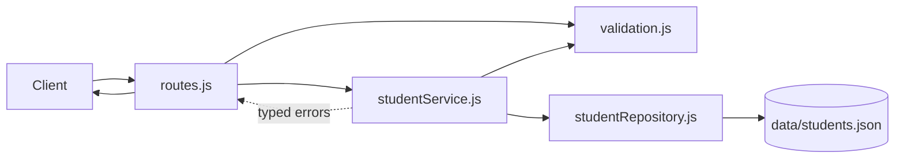

# Architecture: Student Management

Based on `docs/requirements.md` (approved). Repo is empty (no existing code or stack).

## 1. Stack recommendation
**Node.js 26 (JavaScript, CommonJS), zero runtime dependencies.** HTTP via built-in `node:http`, tests via built-in `node:test` + `node:assert`, run with `node --test`.
- Installed: Node 26.13.1, npm 12.2.3, Python 3.15.2. No Java/.NET. Node covers server, JSON, and test runner with nothing to install (NFR-4, NFR-5).
- Persistence: in-memory `Map` backed by a single JSON file (`data/students.json`, path overridable via optional `DATA_FILE` env), written after each successful change. Write is synchronous and atomic: `writeFileSync` to `students.json.tmp` in the same directory, then `renameSync` over the target; the temp file is removed on error. No fsync (optional at this scope). Chosen over SQLite because the data is one small table, single user (requirements s5); it needs no native or experimental module, and tests can run against a temp file or purely in memory.
- Concurrency: every mutation does check + build new state + persist + swap in one synchronous section (no `await` in between), so overlapping requests cannot interleave and FR-9/NFR-2 hold.
- A small REST API lets the verification and PR phases exercise real behavior over HTTP.

## 2. Components
| Component | File | Responsibility |
|---|---|---|
| Server bootstrap | `src/server.js` | Export `createServer({filePath, host, port})` (wires dependencies, returns the server); call `listen` only under `require.main === module`, with `PORT` (default 3000), `HOST` (default `127.0.0.1`, loopback only; env-overridable), optional `DATA_FILE`. Relies on `server.headersTimeout`/`requestTimeout` (Node defaults or set explicitly). Sends no CORS headers |
| Router / handlers | `src/routes.js` | Apply the routing rule (s4), parse ID and JSON body (streaming size limit, content-type check), call service, map results/errors to HTTP responses, log requests |
| Validator | `src/validation.js` | Normalize and validate student input (one function used by add and update, NFR-3), returning a fresh object built from exactly `name`, `email`, `course`; validate ID format |
| Student service | `src/studentService.js` | Business rules: create, list, get, update, delete; duplicate-email check; throws typed errors |
| Repository | `src/studentRepository.js` | `Map` storage of records and email index, ID counter; JSON-file load/validate/save; email lookup (lowercased); accepts an injectable writer (default: temp-file + rename) so tests can force save failures |
| Errors | `src/errors.js` | Typed errors (`ValidationError`, `InvalidIdError`, `NotFoundError`, `ConflictError`, ...) carrying code and HTTP status |

Dependency direction: routes -> service -> repository; routes and service use validator and errors.

## 3. Data model
Entity `Student`:
| Field | Type | Constraints |
|---|---|---|
| `id` | integer | System-assigned, positive, starts at 1, strictly increasing, never reused (counter `nextId` persisted with the data), never accepted from client |
| `name` | string | Required; trimmed; 1-100 chars |
| `email` | string | Required; trimmed; checked in order: `length <= 254`, then regex `^[^\s@]+@[^\s@.]+(\.[^\s@.]+)+$` (linear-time, no nested quantifiers; no whitespace of any kind). Stored as entered (trimmed) |
| `course` | string | Required; trimmed; 1-100 chars |

Uniqueness: `email` unique by `trim().toLowerCase()`. Same name is allowed. On update, the student's own current email does not count as a duplicate.

File format: `{ "nextId": <int>, "students": [ {id,name,email,course}, ... ] }`.

Load rule (at startup):
- File missing: start empty (`nextId` = 1); `data/` is created with `mkdir({recursive:true})` before the first save.
- File present but invalid: **fail startup** with a clear log message (no student data in it); never auto-reset or overwrite. Invalid means: not parseable JSON, not an object, `nextId` not a safe positive integer, any record failing the validator or having an invalid/non-unique `id`, or emails not unique (case-insensitive).
- After a valid load: `nextId = max(nextId, maxId + 1)`, so IDs are never reused.
- Records and the email index are held in `Map`s (never plain-object keyed by user data).

## 4. API contract
Base path `/students`, JSON only. Student JSON: `{ "id", "name", "email", "course" }`. `POST`/`PUT` must send `Content-Type: application/json` (parameters such as `charset` allowed), otherwise `415`. No CORS headers are sent, so cross-origin browser calls fail preflight.

**Routing rule (single, applied first).** Strip the query string (ignored), then match the path against `^/students(?:/([^/]*))?/?$`.
- No ID segment, or an empty one (`/students`, `/students/`): collection. `GET` = list, `POST` = add; `PUT`/`DELETE` = `400 INVALID_ID` (AC-10); other methods = `405`.
- One ID segment (`/students/5`, `/students/5/`): `GET`/`PUT`/`DELETE` act on that ID (segment validated per ID rule below); other methods (including `POST`) = `405`.
- Anything deeper or not matching (`/students/1/x`, `/other`) = `404 ROUTE_NOT_FOUND`.

**ID rule.** Decode the segment once; it must match `^[1-9]\d*$` (so `%31` decodes to `1` and is fine, while `1%00`, `1e3`, `0x10`, ` 5 `, `007`, `0`, `-1`, `1.5` are rejected), then `Number(seg) <= Number.MAX_SAFE_INTEGER`. Never use `parseInt`/`Number` for the validity decision. Rejecting leading zeros is a deliberate choice stricter than "non-numeric".

Bodies on `GET`/`DELETE` are ignored (not buffered).

| Operation | Request | Success | FR |
|---|---|---|---|
| Add | `POST /students` body `{name,email,course}` | `201` + created student; `Location: /students/{id}` | FR-1, FR-2 |
| List | `GET /students` | `200` + array (`[]` if none), ordered by id | FR-3 |
| Get | `GET /students/{id}` | `200` + student | FR-4 |
| Update | `PUT /students/{id}` body `{name,email,course}` (full replacement; id unchanged) | `200` + updated student | FR-5 |
| Delete | `DELETE /students/{id}` | `204`, no body | FR-6 |

Unknown body fields (including `id`) are ignored; they never change the ID.

### Error format
All failures return `Content-Type: application/json`:
```
{ "error": { "code": "<CODE>", "message": "<specific cause>", "fields": [ { "field": "email", "message": "..." } ] } }
```
`fields` is present only for `VALIDATION_ERROR`.

| Condition | Status | `code` | FR / AC |
|---|---|---|---|
| Required field missing, blank, or not a string; malformed value (bad email, too long) | 422 | `VALIDATION_ERROR` (one `fields` entry per offending field, naming the field) | FR-7, FR-8 / AC-6, AC-7 |
| Request body is not valid JSON or not a JSON object | 400 | `INVALID_JSON` | NFR-1 |
| ID missing (`PUT /students`, `DELETE /students`, `PUT /students/`), empty, or failing the ID rule above (non-numeric, zero, negative, decimal, leading zeros, above `Number.MAX_SAFE_INTEGER`) | 400 | `INVALID_ID` | FR-11 / AC-10 |
| Valid ID, no such student | 404 | `NOT_FOUND` | FR-10 / AC-9 |
| Email already used by another student (case-insensitive) | 409 | `CONFLICT` (message names `email`) | FR-9 / AC-8 |
| Unknown or too-deep path | 404 | `ROUTE_NOT_FOUND` (fixed message, path not echoed) | - |
| Known path, unsupported method | 405 | `METHOD_NOT_ALLOWED` (`Allow` header optional) | - |
| `POST`/`PUT` without `application/json` content type | 415 | `UNSUPPORTED_MEDIA_TYPE` | - |
| Body larger than 10 KB | 413 | `PAYLOAD_TOO_LARGE` (fixed message; `Connection: close`) | - |
| Unexpected failure, including failed save | 500 | `INTERNAL_ERROR`, generic message only | NFR-2 |

Fixed messages (never built from input) are used for `INVALID_JSON`, `ROUTE_NOT_FOUND` and `PAYLOAD_TOO_LARGE`; `SyntaxError.message` is never passed through.

Body limit: bytes are counted while the request streams (covers chunked bodies, not just `Content-Length`). On overflow, stop reading, respond `413` with `Connection: close`, and destroy the request. Slow-client protection relies on the server's `headersTimeout`/`requestTimeout`.

Check order per request (first failing check wins):
1. route/method (404 `ROUTE_NOT_FOUND` / 405; `PUT`/`DELETE` with missing ID are 400 per the routing rule)
2. ID format (400)
3. content type, `POST`/`PUT` only (415)
4. body size, enforced while reading (413)
5. body JSON, must be an object (400)
6. update only: existence (404)
7. field validation (422)
8. duplicate email (409)

So an invalid ID on update is 400 even with a bad body, and `PUT /students/999` with an invalid body is 404, not 422 (AC-9).

## 5. Interaction flow

Each flow follows the check order in s4 and runs the service call (check + build + persist + swap) synchronously.
Add: parse body -> validate -> check duplicate email -> build new state with `nextId` -> save file -> swap in memory -> 201.
Update: validate ID -> parse body -> find (404) -> validate fields (422) -> duplicate check excluding own id (409) -> build new state -> save -> swap -> 200.
Delete: validate ID -> find (404) -> build state without record -> save -> swap -> 204.

## 6. Error handling and validation strategy
- All validation and rule checks happen before any write. Persistence is build-then-swap (no rollback): compute the new state, write it (`students.json.tmp` then rename), and only then replace the in-memory state. A failed request never changes stored data (NFR-2). If saving fails, the temp file is removed, in-memory state stays unchanged, `nextId` is not consumed, and `500 INTERNAL_ERROR` is returned.
- One validator is used by add and update (NFR-3). It collects all field errors in one pass and returns a fresh object built from exactly `name`, `email`, `course` by explicit picks; the request body is never merged, spread or assigned into a record, so `__proto__`/`constructor` keys have no effect. Maps are used for storage and the email index.
- Services throw typed errors; a single catch in `routes.js` converts them to the error format. Anything untyped becomes `500 INTERNAL_ERROR` with no stack trace or internals in the response; details go to server log only.
- Storage uses plain data operations (no SQL, no string-built queries), so there is no injection surface. Input is always treated as data; responses are JSON only.
- Messages are specific (e.g. `"email: must be a valid email address"`, `"Student 7 not found"`, `"Email already in use"`) and never echo stored data of other students. Exceptions: `INVALID_JSON`, `ROUTE_NOT_FOUND`, `PAYLOAD_TOO_LARGE` use fixed messages.
- Logging records only method, path (without query), status and error code. Request bodies and student data are never logged. Startup failures on a bad data file log the cause, not file contents.

## 7. Testing approach and project layout
```
src/    server.js routes.js validation.js studentService.js studentRepository.js errors.js
tests/  validation.test.js     (unit: required/blank/format/length, ID format, email cases, __proto__/constructor keys)
        studentService.test.js (service + in-memory repository: CRUD, duplicates, ID not reused)
        api.test.js            (HTTP: createServer on port 0, host 127.0.0.1, temp data file; status codes + error format)
data/   students.json          (created at runtime; must be git-ignored)
package.json                   ("start": "node src/server.js", "test": "node --test tests/")
```
- `createServer({filePath, host, port})` is exported from `server.js`; `listen` runs only under `require.main === module`. The repository accepts a file path or none (in-memory) and an injectable writer, so tests are isolated and can force a save failure.
- Every FR and AC has at least one test; each error row in section 4 has an API-level test, including "data unchanged after failure" (AC-11), done by injecting a failing writer and asserting 500, unchanged state and `nextId` not consumed.
- Required cases beyond the basics:
  - Email: `abc`, `a@b`, `a@.com`, `a@b.`, `a@@b.c`, `a b@c.d`, `a@b.c\n` rejected; a 255-char email rejected; `a@b.co` accepted.
  - Routing: `PUT /students`, `DELETE /students`, `PUT /students/` -> 400 `INVALID_ID`; `GET /students/` equals list; query string ignored; `/students/1/x` -> `ROUTE_NOT_FOUND`; `POST /students/1` -> 405.
  - ID: `0`, `007`, `1e3`, `0x10`, `12abc`, `%31` (valid), `1%00`, `9007199254740993`.
  - `PUT /students/999` with an invalid body -> 404; invalid ID with bad body -> 400.
  - `text/plain` POST/PUT -> 415; body over 10 KB (Content-Length and chunked) -> 413 with `Connection: close`; body on `GET`/`DELETE` ignored.
  - Body with `__proto__` and `constructor` keys: no effect on stored records or the prototype.
  - Data file: missing -> empty; malformed JSON, wrong shape, duplicate ids/emails -> startup fails and file is untouched; `nextId <= maxId` -> corrected to `maxId + 1`; missing `data/` dir is created on first save.
  - Server binds to `127.0.0.1` by default; error and log output contain no request body or query string.
- Task notes for planning/implementation: add `data/` to `.gitignore` (not done by the Architecture Agent); verification checks that `git status` stays clean after running the server and tests.

## 8. Requirement traceability
| Requirement | Component(s) / endpoint |
|---|---|
| FR-1 | `POST /students`; routes, service, repository |
| FR-2 | repository (`nextId` counter, never reused, `max(nextId, maxId+1)` on load, not consumed on failed save); `201` response returns `id` |
| FR-3 | `GET /students`; service, repository |
| FR-4 | `GET /students/{id}`; service, repository |
| FR-5 | `PUT /students/{id}`; service, repository |
| FR-6 | `DELETE /students/{id}`; service, repository |
| FR-7 | validator (required/blank) -> `422 VALIDATION_ERROR` |
| FR-8 | validator (email format, types, lengths) -> `422 VALIDATION_ERROR` |
| FR-9 | service duplicate check + repository email lookup -> `409 CONFLICT` |
| FR-10 | service lookup -> `404 NOT_FOUND` |
| FR-11 | routing rule + validator ID check in routes -> `400 INVALID_ID` (incl. missing ID on `PUT`/`DELETE`, AC-10) |
| NFR-1 | errors module + single error mapper in routes (error format, fixed messages) |
| NFR-2 | validate/check before write; synchronous build-then-swap with temp-file + rename; failed save -> 500, state unchanged (service, repository) |
| NFR-3 | single shared validator for add and update |
| NFR-4 | zero dependencies, 6 source files, JSON file store |
| NFR-5 | `node:test` suites per layer in `tests/`; `createServer` export and injectable writer for testability |

## 9. Design review resolutions
Source: `docs/design-review.md`.
- DR-1 -> s4 routing rule, error table, s7 routing tests
- DR-2 -> s1 persistence, s3 load rule, s7 data-file tests
- DR-3 -> s1 concurrency, s5 flows, s6 build-then-swap
- DR-4 -> s1 (`DATA_FILE`), s2 bootstrap, s7 task note (`data/` in `.gitignore`, to be done in planning/implementation)
- DR-5 -> s2 server bootstrap (`HOST` default `127.0.0.1`)
- DR-6 -> s3 email rule, s7 email test cases
- DR-7 -> s4 check order (update: 404 before 422; 413/415 included), s5 update flow
- DR-8 -> s4 ID rule, s7 ID tests
- DR-9 -> s2 bootstrap, s4 body limit, s7 413 tests
- DR-10 -> s4 (415, no CORS), s2, s7
- DR-11 -> s2 validator, s3 `Map` storage, s6, s7 `__proto__` tests
- DR-12 -> s4 fixed messages, s6 messages and logging
- DR-13 -> s2 server bootstrap and repository, s7 testing approach
- DR-14 -> s1 atomic write, s6 failed-save behavior
- DR-15 (partial) -> rollback dropped for build-then-swap (s6); `Allow` header made optional (s4); other items (405/404 split, errors carrying HTTP status) intentionally kept as is
